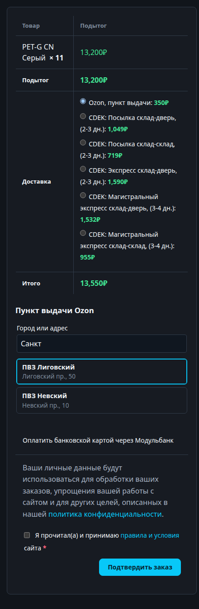

# Ozon Delivery для WooCommerce

[](https://github.com/asovetov/woo-ozon-delivery/releases)
[](LICENSE)


Доставка в пункты выдачи Ozon: кэш ПВЗ, тариф по весу в корзине, выбор пункта в оформлении,
создание заявки из админки и синхронизация статусов через Ozon Delivery API.

Написан для работающего магазина на WooCommerce: без подписок, без посредников, все данные
остаются на своём сервере.



**Статус:** 0.2.0. Весь путь заказа собран и проверен на локальном стенде: активация, кэш
пунктов, поиск и выбор ПВЗ в оформлении, создание заявки кнопкой в заказе, опрос статусов
кроном. С боевыми ключами Ozon не проверялось: для этого нужен магазин с доступом к
Delivery API. Не сделано: печать этикеток, отмена и возвраты через API.

## Что умеет

- **Кэш пунктов выдачи.** Ozon отдаёт ПВЗ страницами по курсору, плагин складывает их в свою
  таблицу и ищет по городу и адресу без запроса к API. Закрытые пункты при обновлении удаляются.
- **Цену считает Ozon.** Как только покупатель выбрал пункт выдачи и указал телефон, плагин
  спрашивает стоимость у `/v1/order/checkout` (этот запрос только считает, заявку не создаёт)
  и подставляет её в способ доставки. Запасной тариф по весу нужен в двух случаях: пока пункт
  не выбран и если Ozon не ответил.
- **Клиент Ozon Delivery API.** OAuth `client_credentials`, кэш токена, повтор запроса после
  редиректа 307 с cookie `__Secure-ETC`, одна повторная попытка на `429` и `5xx`.
- **Выбор пункта в оформлении.** Поиск по кэшу, выбранный пункт переживает пересборку
  оформления, сохраняется в заказ, виден в админке и в письмах.
- **Создание заявки с ключом идемпотентности.** Повторное нажатие кнопки не создаёт вторую
  посылку; номер заявки и посылки остаются в заказе.
- **Синхронизация статусов.** Крон раз в 30 минут опрашивает `/v1/posting/info` и переводит
  заказ в «Выполнен» или «Отменён», ошибки пишет в заметки заказа.
- **Совместимость с HPOS** объявлена.

## Установка

```bash
cd wp-content/plugins
git clone https://github.com/asovetov/woo-ozon-delivery.git
```

Дальше в админке:

1. Активируйте плагин в разделе «Плагины».
2. WooCommerce → Ozon Delivery: укажите Client ID и Client Secret из личного кабинета Ozon
   (Настройки → API).
3. Нажмите «Обновить пункты выдачи», плагин загрузит ПВЗ в кэш.
4. WooCommerce → Настройки → Доставка: добавьте метод «Ozon» в нужную зону и задайте тарифы.

## Настройки

| Параметр | Что делает |
|---|---|
| Client ID / Secret | Доступ к Ozon Delivery API |
| URL токена, URL API, Scope | По умолчанию боевые адреса Ozon |
| Вес и габариты по умолчанию | Подставляются, если у товара не заполнены |
| Запасной тариф по весу | Показывается, пока пункт не выбран или если Ozon не ответил |
| Наценка на доставку, ₽ | Упаковка и обработка |

Запасные тарифы по весу задаются строками `до_кг:цена`:

```
1:350
3:450
5:600
10:900
```

Если вес не попал ни в одну полосу, применяется базовая стоимость.

## Свои статусы заказов

По умолчанию статусы Ozon переводятся в штатные: `processing`, `completed`, `cancelled`,
`on-hold`. Если в магазине свои статусы («Доставляется», «Готов к выдаче»), их подключают
фильтром:

```php
add_filter( 'woo_ozon_status_map', function ( array $map ): array {
	$map['sent']             = 'wc-shipped';
	$map['delivering']       = 'wc-shipped';
	$map['ready_for_pickup'] = 'wc-ready-to-pickup';

	return $map;
} );
```

## Почему клиент выглядит необычно

Каждый POST к Ozon Delivery API сначала отвечает `307` с cookie `__Secure-ETC` и отдаёт данные
только при повторе того же запроса с этой cookie. Автоматическое следование за редиректом
зацикливается на `?__rr=N`, поэтому плагин обрабатывает редирект сам и повторяет запрос.

## Требования

- WordPress 6.4+
- WooCommerce 8.0+ (проверено на 11.3)
- PHP 8.1+

## Безопасность

- Действия в админке требуют `manage_woocommerce`, формы проверяют nonce.
- Ввод очищается (`sanitize_text_field`, `absint`, `esc_url_raw`), вывод экранируется.
- Запросы к своей таблице идут через `$wpdb->prepare`.
- Ключи API хранятся в опциях WordPress и не попадают в логи и в HTML.
- При удалении плагина настройки, кэш, расписание и временные данные удаляются (`uninstall.php`).

## Лицензия

GPL-3.0-or-later. См. [LICENSE](LICENSE).

---

# Ozon Delivery for WooCommerce (EN)

WooCommerce shipping plugin for Ozon pickup points: pickup point cache, delivery price from
Ozon itself, pickup point selection at checkout, shipment creation from the order screen and
status sync through the Ozon Delivery API.

Self-hosted: no subscriptions, no third-party services, all data stays on your server.

**Status:** 0.2.0. The full order flow is implemented and tested on a local stand: activation,
point cache, checkout selection, shipment creation, cron status polling. Not tested with live
Ozon credentials: that requires a store with Delivery API access. Not implemented: label
printing, cancellation and returns via API.

### Why the API client looks unusual

Every POST to the Ozon Delivery API answers `307` with a `__Secure-ETC` cookie and only returns
data when the same request is replayed with that cookie. Following redirects automatically loops
on `?__rr=N`, so the plugin handles the redirect explicitly. `429` and `5xx` get one retry.

### Custom order statuses

Ozon statuses map to core WooCommerce statuses by default. Use the `woo_ozon_status_map` filter
to map them to your own.

### Requirements

WordPress 6.4+, WooCommerce 8.0+ (tested on 11.3), PHP 8.1+. HPOS compatible.

### License

GPL-3.0-or-later. See [LICENSE](LICENSE).
